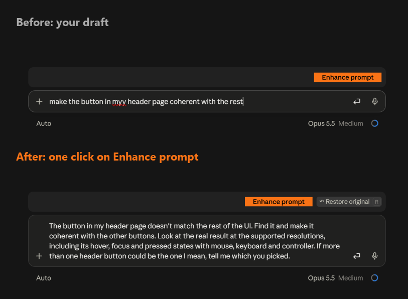

# Prompt Enhancer

A Claude Code mod that turns a vague prompt into a clear one, using the project you are working in.

Type a prompt, click the orange **Enhance prompt** button above the prompt box, review the result, then send it yourself. **Restore original** puts your text back.

From the keyboard, type `/enhance <prompt>` to do the same.



## Install

In a Claude Code terminal session, run:

```
/plugin install prompt-enhancer --marketplace Abdoul-sudo/prompt-enhancer
```

Answer `y` to add the marketplace, then pick the user scope. The mod then loads in every session, the desktop app's Code tab included.

### Better results: project-context.md

The mod gives better rewrites when your project has a `project-context.md` file: a short description of the project, its main parts, its key files and the names you use. The file goes in the folder where you start Claude Code. The mod reads up to 20,000 characters of it.

- **Create it:** when the file is missing, a blue **Create project context** button shows to the left of **Enhance prompt**. Click it once: Claude writes the file with the mod's `project-context` skill.
- **Keep it current:** Claude uses the same skill on its own to update the file after changes that add, remove or rename features, parts or key files. It never creates the file on its own. You can also run `/prompt-enhancer:project-context` at any time.

## How it works

- The enhancer reads the draft in your prompt box.
- The AI reads the last 8 exchanges of your conversation: your messages and Claude's replies.
- The AI reads your `project-context.md` if it exists, up to 20,000 characters.
- The AI rewrites the prompt for the model you use in the current session.
- The enhancer puts the new prompt in your prompt box. Nothing is sent.

## Model

| Setting | Value | Why |
| --- | --- | --- |
| Model | `sonnet` (the newest Claude Sonnet) | Good judgment about what to keep and what to add, at a fraction of Opus's cost and wait. |
| Effort | `medium` | As fast as `low` on short drafts in testing (a few seconds), with shorter and cleaner rewrites. |

Each click uses your Claude Code account, like any other request.

### Change the model or effort

1. Open `hooks/register.tsx` and edit the two lines at the top:

   ```ts
   const MODEL = 'sonnet'
   const EFFORT = 'medium'
   ```

   - `MODEL`: an alias (`haiku`, `sonnet`, `opus`) or a full model id such as `claude-opus-5-5`.
   - `EFFORT`: `low`, `medium`, `high`, `xhigh` or `max`. Higher is slower and costs more.

2. Start a new session, or run `/reload-plugins` in a terminal session.

An update replaces the installed files, so edits made there are lost when you update. To keep your own settings, fork the repository and install from your fork.

## Update

Claude Code does not update this mod on its own by default: background auto-update is off for every marketplace you add yourself, and a marketplace cannot turn it on for you.

### Turn on automatic updates (recommended)

Do this once:

1. In a Claude Code terminal session, run `/plugin`.
2. Open **Marketplaces** and select `prompt-enhancer`.
3. Select **Enable auto-update**.

Claude Code then checks for a new version in the background after a session starts. A new version applies from the next session.

### Update by hand

In your shell:

```
claude plugin marketplace update prompt-enhancer
claude plugin update prompt-enhancer@prompt-enhancer
```

Then start a new session.

## Files

| Path | What it holds |
| --- | --- |
| `.claude-plugin/plugin.json` | The mod's manifest. |
| `.claude-plugin/marketplace.json` | Makes this repository its own marketplace, so it installs with one line. |
| `hooks/register.tsx` | The mod: the button, the rewrite instructions and the model call. |
| `hooks/color_button.tsx` | The colored buttons, drawn as their own region so the desktop app keeps their color. |
| `skills/project-context/SKILL.md` | The skill that creates and updates `project-context.md`. |
| `types/index.d.ts` | The types of the values the mod keeps for the session. |
| `tests/enhance.test.tsx` | Tests, run with `claude plugin test .` |
| `docs/before-after.png` | The example image above. |

## License

[MIT](LICENSE)
