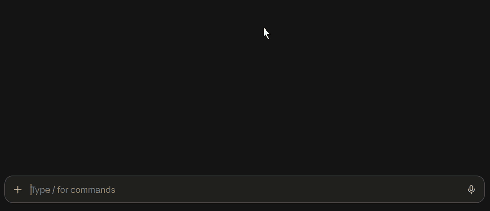
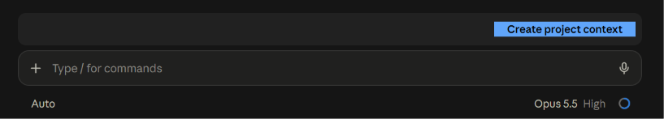

<h1 align="center">Prompt Enhancer</h1>

<p align="center">
  <em>Turn a rough prompt into one that gets a better result, in one click.</em>
</p>

<p align="center">
  
  
  
</p>

<p align="center">
  
</p>

<p align="center">
  <a href="#quick-start">Quick start</a> ·
  <a href="#update">Update</a> ·
  <a href="#usage">Usage</a> ·
  <a href="#how-it-works">How it works</a> ·
  <a href="#project-context">Project context</a> ·
  <a href="#in-the-terminal">Terminal</a> ·
  <a href="#model">Model</a> ·
  <a href="#privacy-and-access">Privacy</a>
</p>

---

## What it does

- **Improves your prompt in one click**: a short draft becomes a clear prompt that gets a better result.
- **Knows your project**: it reads your chat and a short description of your project.
- **Lets you check first**: the new prompt goes in the prompt box, and you send it yourself.
- **Gives your draft back**: one click restores your original text.

## Quick start

1. Install Prompt Enhancer:

   ```sh
   claude plugin marketplace add Abdoul-sudo/prompt-enhancer
   claude plugin install prompt-enhancer@prompt-enhancer
   ```

2. Restart Claude Code.

When you type in the prompt box, an orange **Enhance prompt** button then appears above it.

## Update

By default, Claude Code does not update Prompt Enhancer. You can turn on automatic updates one time:

1. In Claude Code, type `/plugin`.
2. Open the **Marketplaces** tab.
3. Select **prompt-enhancer**.
4. Select **Enable auto-update**.

After that, each new version comes when you start a session.

You can also update by hand, with these commands:

```sh
claude plugin marketplace update prompt-enhancer
claude plugin update prompt-enhancer@prompt-enhancer
```

Then restart Claude Code, or type `/reload-plugins`.

## Usage

1. **Enhance prompt** rewrites the draft in the prompt box. The result takes the place of your draft.
2. **↶ Restore original** puts your draft back.

Nothing goes to Claude until you send the prompt.

| Command | What it does |
| --- | --- |
| `/enhance <prompt>` | Rewrites `<prompt>` and puts the result in the prompt box. |
| `/prompt-enhancer:create-project-context` | Creates `project-context.md`. |
| `/prompt-enhancer:project-context` | Updates `project-context.md`. |

## How it works

To rewrite your draft, the mod reads:

- your draft;
- the last 8 exchanges of your chat (your messages and Claude's replies);
- your `project-context.md`, if you have one.

The new prompt:

- keeps what you asked for. A question stays a question.
- makes the goal clear, and asks for the real cause of a problem.
- says how to check that the result works.
- keeps your code, paths and error messages exactly as you wrote them.
- adds no file names or facts that the project does not show.
- gives no steps. Claude picks its own method, as Anthropic's [prompting best practices](https://platform.claude.com/docs/en/build-with-claude/prompt-engineering/claude-prompting-best-practices) advise.

Inspired by Felix Rieseberg's [How to be more ambitious](https://felixrieseberg.com/how-to-be-more-ambitious-a-tutorial-for-humans-with-models/).

## Project context

`project-context.md` is a short description of your project and its features, at the root of the project. With it, the mod writes better prompts.

When the file is missing, a blue **Create project context** button appears above the prompt box. Claude then writes the file in your chat, with Opus at high effort. It asks you about what it cannot find in the project.

<p align="center">
  
</p>

After big changes to the project, Claude updates the file with the model of your session.

## In the terminal

The mod works in the terminal too. Clicks on the buttons need the fullscreen mode: `/tui fullscreen`. Without it, the `/enhance <prompt>` command does the same work.

## Model

The mod uses Sonnet at medium effort. Each rewrite counts on your Claude Code plan.

To use another model, change `MODEL` and `EFFORT` at the top of `hooks/register.tsx`, then start a new session. An update removes this change. To keep it, fork the repository.

## Privacy and access

The mod runs in Claude Code. This is everything it can access:

| Access | What the mod does |
| --- | --- |
| Reads | Your draft, the last 8 exchanges of the chat, and `project-context.md`. |
| Sends | These texts to Claude, with your Claude Code account, to write the new prompt. |
| Writes | Only the prompt box. Claude writes `project-context.md` when you ask for it. |
| Network | Nothing else. |

## Uninstall

```sh
claude plugin uninstall prompt-enhancer@prompt-enhancer
```

## License

[MIT](LICENSE)
