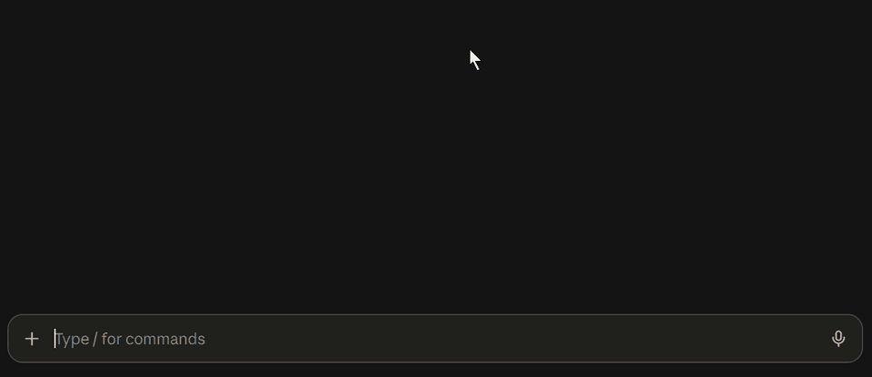
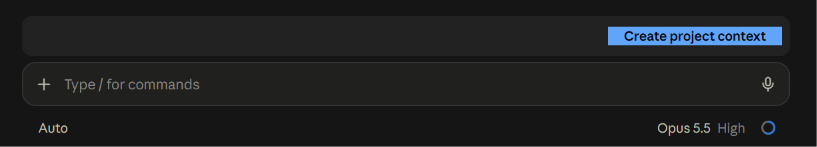

# Prompt Enhancer

A Claude Code mod that turns a rough prompt into one that gets a better result.

Type a prompt, then click the orange **Enhance prompt** button above the prompt box. Review the result and send it yourself. **Restore original** puts your text back.

You can also type `/enhance <prompt>` and press Enter. Nothing goes to Claude: the result goes in the prompt box.



## Install

In a Claude Code terminal session, run:

```
/plugin install prompt-enhancer --marketplace https://github.com/Abdoul-sudo/prompt-enhancer.git
```

Answer `y`, then pick the user scope. The mod loads in every session, the desktop app included.

## How it works

The mod reads:

- your draft;
- the last 8 exchanges of your chat (your messages and Claude's replies);
- your `project-context.md`, if you have one.

Then it rewrites your draft the way an expert would:

- It keeps what you asked for. A question stays a question.
- It makes the goal clear and asks for the real cause of a problem.
- It says how to check that the result works.
- It adds no file names of its own.
- It gives no approach or steps, so Claude picks its own method: Anthropic's [prompting best practices](https://platform.claude.com/docs/en/build-with-claude/prompt-engineering/claude-prompting-best-practices) advise general instructions over prescriptive steps.

Inspired by Felix Rieseberg's [How to be more ambitious](https://felixrieseberg.com/how-to-be-more-ambitious-a-tutorial-for-humans-with-models/).

## Project context

Add a `project-context.md` file to your project: a short description of the project and its features. The mod reads it to write better prompts.

- **Create it:** click the blue **Create project context** button. It shows when the file is missing. Claude writes the file in your chat and asks about what it can't find in the project.
- **Keep it current:** Claude updates the file after big changes. You can also run `/prompt-enhancer:project-context`.



## Model

The mod uses the `sonnet` model at `medium` effort. Each click counts on your Claude Code account.

To change this, edit `MODEL` and `EFFORT` at the top of `hooks/register.tsx`. Then start a new session. An update deletes your edits. To keep them, fork the repository.

## Update

Run these two commands in your shell:

```
claude plugin marketplace update prompt-enhancer
claude plugin update prompt-enhancer@prompt-enhancer
```

Then start a new session.

To update on its own: run `/plugin` in a terminal session. Open **Marketplaces**, pick `prompt-enhancer`, then pick **Enable auto-update**.

The Claude desktop app never updates plugins on its own. Run the two commands above from time to time.

## License

[MIT](LICENSE)
